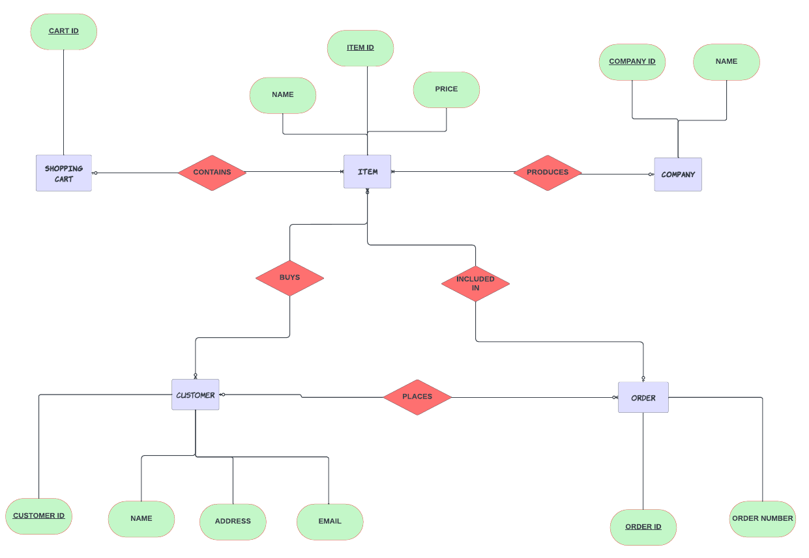
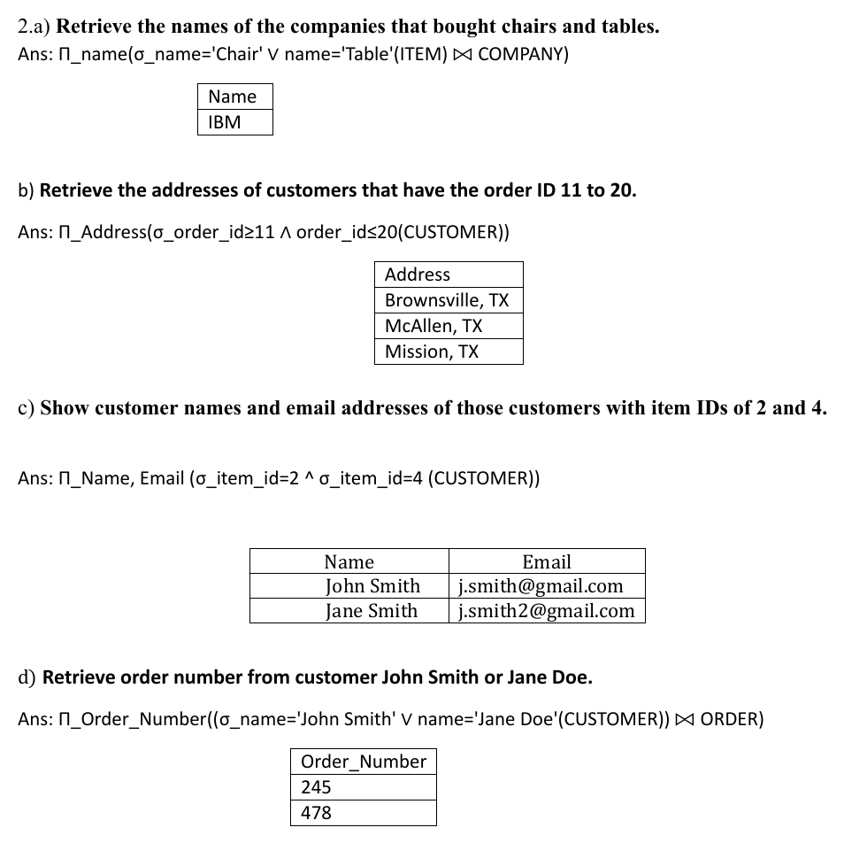

# Shopping Cart Database Design


A relational database design for an online shopping cart: an entity–relationship model, the relational schema with sample data, and relational-algebra queries with worked results. MySQL-style SQL is included so the design can be recreated and queried directly.

## Key Results

- **5 entities, 5 relations** — COMPANY, ITEM, SHOPPING_CART, ORDER, and CUSTOMER, modeled end-to-end from ER diagram to MySQL schema with primary and foreign keys.
- **5 relationships** — a cart *contains* items, a company *produces* items, a customer *buys* items, an item is *included in* an order, and a customer *places* an order, with mandatory/optional participation worked out for each.
- **4 relational-algebra queries with worked results** — selection, projection, and join queries answered on the sample data, e.g. the companies selling chairs and tables (IBM) and the order numbers for John Smith and Jane Doe (245, 478).
- **Runnable schema** — `sql/schema.sql` creates all five tables and loads the sample data: 3 companies, 3 items, 3 customers, 4 carts, and 4 orders, with foreign keys enforced.

## Entity–relationship diagram



*The ER model: five entities with their attributes and keys, connected by the CONTAINS, PRODUCES, BUYS, INCLUDED IN, and PLACES relationships. Full-size version: `diagrams/er-diagram.pdf`.*

## Entities and relationships

| Entity | Attributes | Key |
| --- | --- | --- |
| COMPANY | company_id, name | company_id |
| ITEM | item_id, name, price, company_id, cart_id, order_id, customer_id | item_id |
| SHOPPING_CART | cart_id | cart_id |
| ORDER | order_id, order_number | order_id |
| CUSTOMER | customer_id, name, address, email, order_id, item_id | customer_id |

Relationships:

- A **shopping cart contains** items; a company **produces** items.
- A customer **buys** items; an item is **included in** an order.
- A customer **places** an order.

## Relational schema

The five relations derived from the ER model, with primary and foreign keys. `ORDER` is quoted in the SQL because `ORDER` is a reserved word in MySQL. Sample data ships with the schema — for example, ITEM holds a Chair ($50.50, IBM), a Table ($155.60, IBM), and a Sofa ($225.20, Tesla), and CUSTOMER holds John Smith (Brownsville, TX), Jane Doe (McAllen, TX), and Jane Smith (Mission, TX).

## Relational-algebra queries

Four queries over the sample data, with the algebra and the worked results shown in `report/Shopping_Cart_Database_Design.pdf` and `queries/relational-algebra-queries.docx`:

1. Names of the companies that sell chairs and tables → **IBM**
2. Addresses of customers with order IDs 11–20 → Brownsville, TX; McAllen, TX; Mission, TX
3. Names and email addresses of customers with item IDs 2 and 4 → John Smith, Jane Smith
4. Order numbers for customers John Smith or Jane Doe → 245, 478



*The four queries written in relational algebra (selection, projection, join) with their results on the sample data.*

## How to Run

Requires MySQL (5.7+ or 8.0). Load the schema and sample data:

```bash
mysql -u root -p -e "CREATE DATABASE IF NOT EXISTS shopping_cart;"
mysql -u root -p shopping_cart < sql/schema.sql
```

Then query it, for example — companies selling chairs and tables:

```sql
USE shopping_cart;
SELECT DISTINCT c.name
FROM COMPANY c
JOIN ITEM i ON i.company_id = c.company_id
WHERE i.name IN ('Chair', 'Table');
-- IBM
```

## Files

| Path | Contents |
| --- | --- |
| `README.md` | This overview |
| `LICENSE` | MIT license |
| `sql/schema.sql` | `CREATE TABLE` statements and sample data for all five relations |
| `diagrams/er-diagram.pdf` | The ER diagram |
| `images/er-diagram-1.png` | ER diagram as a PNG figure |
| `images/report-page-2.png` | The four relational-algebra queries with worked results |
| `report/Shopping_Cart_Database_Design.pdf` | Full design write-up: ER diagram and queries with results |
| `queries/relational-algebra-queries.docx` | The four relational-algebra queries with results (editable) |

## License

MIT — see [LICENSE](LICENSE).
